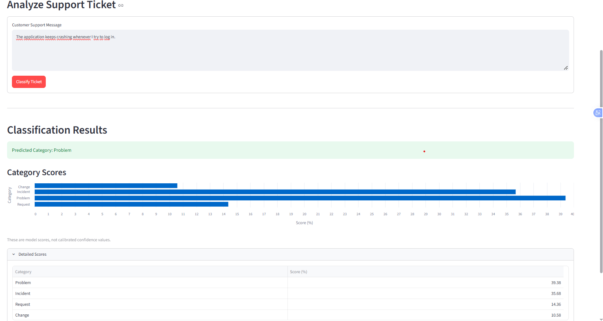

# SmartTicket AI 🎫

**An end-to-end, English-language customer-support ticket classification prototype.**

SmartTicket AI classifies support messages into four ticket types — **Incident**, **Problem**, **Request**, and **Change** — using a TF-IDF + Logistic Regression pipeline. It includes a FastAPI prediction service, a Streamlit dashboard, automated API tests, and Docker Compose configuration.

> **Status:** Working local prototype. It has been tested locally and with Docker, but it is **not publicly deployed**. Predictions are intended for demonstration, not autonomous support decisions.

## Features

- Text classification based on a support ticket's subject and body
- Model experimentation: Logistic Regression, Linear SVM, Naive Bayes, and a majority-class baseline
- Stratified train/validation/test split and five-fold cross-validation
- Model evaluation using accuracy, precision, recall, Macro F1, and a confusion matrix
- `POST /predict` API endpoint with input validation and per-class scores
- Streamlit UI with a score chart and API connection status
- Automated FastAPI endpoint tests and local Docker Compose setup

## Architecture

```text
Browser → Streamlit dashboard (:8501)
                  ↓ HTTP request
             FastAPI (:8000)
                  ↓
      Saved TF-IDF + Logistic Regression pipeline
                  ↓
         Prediction + class scores
```

The Streamlit app calls FastAPI rather than loading the ML model directly. FastAPI loads the locally generated `models/ticket_classifier.joblib` file on startup.

## Dataset

Source: [Customer Support Tickets — Hugging Face](https://huggingface.co/datasets/vasu1111/customer-support-tickets).

- The dataset contains **synthetic** customer-support tickets in English and German.
- This experiment reads the **first 5,000 rows**, filters to English, prepares `subject + body` as the model input, and removes duplicate texts.
- Prepared dataset: **2,755** English-language records.
- Target label: `type`, with four classes (Incident, Problem, Request, Change).
- Training: **1,927** rows; validation: **414** rows; held-out test: **414** rows.
- For final fitting, training and validation are combined (**2,341** rows); the **414** test rows remain separate.

**Dataset license:** CC BY-NC 4.0. Follow its attribution and noncommercial-use conditions. Dataset contents are not committed to this repository.

## Model development

The text preprocessing/classification pipeline uses:

- `TfidfVectorizer(max_features=10000, ngram_range=(1, 2), min_df=2, sublinear_tf=True)`
- `LogisticRegression(max_iter=1000, class_weight="balanced", random_state=42)`

Model selection used validation-set Macro F1 and five-fold stratified cross-validation on the training split. TF-IDF is fitted inside each training pipeline to reduce data leakage.

### Five-fold cross-validation results (training split)

| Model                   | Mean Macro F1 | Fold standard deviation |
| ----------------------- | ------------: | ----------------------: |
| Logistic Regression     |        0.8212 |                  0.0127 |
| Linear SVM              |        0.8200 |                  0.0107 |
| Multinomial Naive Bayes |        0.4754 |                  0.0278 |
| Majority-class baseline |        0.1476 |                  0.0002 |

Logistic Regression was selected as a practical candidate. Its result is very close to Linear SVM; the small difference does not establish that it is universally better.

### Final held-out test results

| Metric              |               Value |
| ------------------- | ------------------: |
| Accuracy            | **0.8333 (83.33%)** |
| Macro F1            | **0.8524 (85.24%)** |
| Correct predictions |       **345 / 414** |

| Class    | Precision | Recall |   F1 |
| -------- | --------: | -----: | ---: |
| Change   |      0.95 |   0.97 | 0.96 |
| Incident |      0.83 |   0.77 | 0.80 |
| Problem  |      0.62 |   0.70 | 0.66 |
| Request  |      0.99 |   0.98 | 0.99 |

**Main error pattern:** Incident and Problem tickets are frequently confused. These metrics describe performance on one held-out split of the synthetic dataset; they are **not** claims of production performance.

## Getting started (Windows PowerShell)

**Requirements:** Python 3.13, Git, and an internet connection to access the dataset. Docker Desktop is optional for containerized execution.

```powershell
git clone https://github.com/gamzeozates/smartticket-ai.git
cd smartticket-ai
python -m venv .venv
.\.venv\Scripts\Activate.ps1
python -m pip install -r requirements.txt
```

### Prepare data and train the model

The processed CSVs and trained model are generated locally; they are excluded from Git.

```powershell
python src/prepare_data.py
python src/finalize_model.py
```

This generates `data/processed/*.csv` and `models/ticket_classifier.joblib`.

### Run locally without Docker

In terminal 1:

```powershell
python -m uvicorn src.api:app --reload
```

In terminal 2 (with the same virtual environment activated):

```powershell
python -m streamlit run src/dashboard.py
```

Open:

- Dashboard: <http://localhost:8501>
- Interactive API docs: <http://localhost:8000/docs>
- Health endpoint: <http://localhost:8000/health>

### Run with Docker Compose

**First run the data-preparation and model-training commands above** so that `models/ticket_classifier.joblib` exists on the host machine. Docker Compose mounts this model directory into the API container (read-only); the model is intentionally not baked into the image.

Ensure your `compose.yaml` defines a local build for **both** the `api` and `dashboard` services. Then run:

```powershell
docker compose config --quiet
docker compose up --build -d
docker compose ps
```

Visit <http://localhost:8501>. To stop the services:

```powershell
docker compose down
```

## API example

`POST http://localhost:8000/predict`

Request:

```json
{
  "text": "The application keeps crashing whenever I try to log in."
}
```

A successful response contains a `prediction` string, a `scores` object containing four model scores, and a `note` about limitations. The scores are **not calibrated confidence values**.

Requests with empty or whitespace-only `text` are rejected with HTTP `422`.

## Automated tests

```powershell
python -m pytest tests/test_api.py -v
```

The current test suite covers the health endpoint, a valid prediction request, an empty message, and a whitespace-only message. **Four tests passed** in the local development environment.

## Repository layout

```text
smartticket-ai/
├── src/
│   ├── api.py
│   ├── dashboard.py
│   ├── classifier.py
│   ├── data_analysis.py
│   ├── prepare_data.py
│   ├── train_model.py
│   ├── compare_models.py
│   ├── cross_validate_models.py
│   ├── finalize_model.py
│   └── predict.py
├── tests/
│   └── test_api.py
├── data/                 # generated locally; ignored by Git
├── models/               # generated locally; ignored by Git
├── Dockerfile
├── compose.yaml
├── .dockerignore
├── .gitignore
├── requirements.txt
└── README.md
```

## Limitations and future work

- **English-only** classifier; there is no verified Turkish-language support.
- Synthetic training data may not reflect real-world ticket distributions or terminology.
- The four categories can overlap semantically, especially Incident and Problem.
- Class probability scores are not calibrated; no automatic decisions should be based on them alone.
- The data source is currently read from an upstream repository without pinning a dataset revision, so retraining later could produce differences.
- The saved model is not stored on GitHub; users must train it locally before running Docker.
- The project is a local prototype, **not a publicly hosted service**.

Potential improvements: probability calibration, low-confidence/manual-review handling, independent real-world evaluation data, multilingual support, pinned data revisions, CI, and public demo deployment with an appropriate model-artifact strategy.

## Data attribution

Dataset: [vasu1111/customer-support-tickets](https://huggingface.co/datasets/vasu1111/customer-support-tickets), listed under **CC BY-NC 4.0**. Follow the dataset's license terms when reusing the dataset or resulting artifacts.

# SmartTicket AI 🎫

**An end-to-end, English-language customer-support ticket classification prototype.**

SmartTicket AI classifies support messages into four ticket types — **Incident**, **Problem**, **Request**, and **Change** — using a TF-IDF + Logistic Regression pipeline. It includes a FastAPI prediction service, a Streamlit dashboard, automated API tests, and Docker Compose configuration.

> **Status:** Working local prototype. It has been tested locally and with Docker, but it is **not publicly deployed**. Predictions are intended for demonstration, not autonomous support decisions.

## Features

- Text classification based on a support ticket's subject and body
- Model experimentation: Logistic Regression, Linear SVM, Naive Bayes, and a majority-class baseline
- Stratified train/validation/test split and five-fold cross-validation
- Model evaluation using accuracy, precision, recall, Macro F1, and a confusion matrix
- `POST /predict` API endpoint with input validation and per-class scores
- Streamlit UI with a score chart and API connection status
- Automated FastAPI endpoint tests and local Docker Compose setup

## Architecture

```text
Browser → Streamlit dashboard (:8501)
                  ↓ HTTP request
             FastAPI (:8000)
                  ↓
      Saved TF-IDF + Logistic Regression pipeline
                  ↓
         Prediction + class scores
```

The Streamlit app calls FastAPI rather than loading the ML model directly. FastAPI loads the locally generated `models/ticket_classifier.joblib` file on startup.

## Dataset

Source: [Customer Support Tickets — Hugging Face](https://huggingface.co/datasets/vasu1111/customer-support-tickets).

- The dataset contains **synthetic** customer-support tickets in English and German.
- This experiment reads the **first 5,000 rows**, filters to English, prepares `subject + body` as the model input, and removes duplicate texts.
- Prepared dataset: **2,755** English-language records.
- Target label: `type`, with four classes (Incident, Problem, Request, Change).
- Training: **1,927** rows; validation: **414** rows; held-out test: **414** rows.
- For final fitting, training and validation are combined (**2,341** rows); the **414** test rows remain separate.

**Dataset license:** CC BY-NC 4.0. Follow its attribution and noncommercial-use conditions. Dataset contents are not committed to this repository.

## Model development

The text preprocessing/classification pipeline uses:

- `TfidfVectorizer(max_features=10000, ngram_range=(1, 2), min_df=2, sublinear_tf=True)`
- `LogisticRegression(max_iter=1000, class_weight="balanced", random_state=42)`

Model selection used validation-set Macro F1 and five-fold stratified cross-validation on the training split. TF-IDF is fitted inside each training pipeline to reduce data leakage.

### Five-fold cross-validation results (training split)

| Model                   | Mean Macro F1 | Fold standard deviation |
| ----------------------- | ------------: | ----------------------: |
| Logistic Regression     |        0.8212 |                  0.0127 |
| Linear SVM              |        0.8200 |                  0.0107 |
| Multinomial Naive Bayes |        0.4754 |                  0.0278 |
| Majority-class baseline |        0.1476 |                  0.0002 |

Logistic Regression was selected as a practical candidate. Its result is very close to Linear SVM; the small difference does not establish that it is universally better.

### Final held-out test results

| Metric              |               Value |
| ------------------- | ------------------: |
| Accuracy            | **0.8333 (83.33%)** |
| Macro F1            | **0.8524 (85.24%)** |
| Correct predictions |       **345 / 414** |

| Class    | Precision | Recall |   F1 |
| -------- | --------: | -----: | ---: |
| Change   |      0.95 |   0.97 | 0.96 |
| Incident |      0.83 |   0.77 | 0.80 |
| Problem  |      0.62 |   0.70 | 0.66 |
| Request  |      0.99 |   0.98 | 0.99 |

**Main error pattern:** Incident and Problem tickets are frequently confused. These metrics describe performance on one held-out split of the synthetic dataset; they are **not** claims of production performance.

## Getting started (Windows PowerShell)

**Requirements:** Python 3.13, Git, and an internet connection to access the dataset. Docker Desktop is optional for containerized execution.

```powershell
git clone https://github.com/gamzeozates/smartticket-ai.git
cd smartticket-ai
python -m venv .venv
.\.venv\Scripts\Activate.ps1
python -m pip install -r requirements.txt
```

### Prepare data and train the model

The processed CSVs and trained model are generated locally; they are excluded from Git.

```powershell
python src/prepare_data.py
python src/finalize_model.py
```

This generates `data/processed/*.csv` and `models/ticket_classifier.joblib`.

### Run locally without Docker

In terminal 1:

```powershell
python -m uvicorn src.api:app --reload
```

In terminal 2 (with the same virtual environment activated):

```powershell
python -m streamlit run src/dashboard.py
```

Open:

- Dashboard: <http://localhost:8501>
- Interactive API docs: <http://localhost:8000/docs>
- Health endpoint: <http://localhost:8000/health>

### Run with Docker Compose

**First run the data-preparation and model-training commands above** so that `models/ticket_classifier.joblib` exists on the host machine. Docker Compose mounts this model directory into the API container (read-only); the model is intentionally not baked into the image.

Ensure your `compose.yaml` defines a local build for **both** the `api` and `dashboard` services. Then run:

```powershell
docker compose config --quiet
docker compose up --build -d
docker compose ps
```

Visit <http://localhost:8501>. To stop the services:

```powershell
docker compose down
```

## API example

`POST http://localhost:8000/predict`

Request:

```json
{
  "text": "The application keeps crashing whenever I try to log in."
}
```

A successful response contains a `prediction` string, a `scores` object containing four model scores, and a `note` about limitations. The scores are **not calibrated confidence values**.

Requests with empty or whitespace-only `text` are rejected with HTTP `422`.

## Automated tests

```powershell
python -m pytest tests/test_api.py -v
```

The current test suite covers the health endpoint, a valid prediction request, an empty message, and a whitespace-only message. **Four tests passed** in the local development environment.

## Repository layout

```text
smartticket-ai/
├── src/
│   ├── api.py
│   ├── dashboard.py
│   ├── classifier.py
│   ├── data_analysis.py
│   ├── prepare_data.py
│   ├── train_model.py
│   ├── compare_models.py
│   ├── cross_validate_models.py
│   ├── finalize_model.py
│   └── predict.py
├── tests/
│   └── test_api.py
├── data/                 # generated locally; ignored by Git
├── models/               # generated locally; ignored by Git
├── Dockerfile
├── compose.yaml
├── .dockerignore
├── .gitignore
├── requirements.txt
└── README.md
```

## Limitations and future work

- **English-only** classifier; there is no verified Turkish-language support.
- Synthetic training data may not reflect real-world ticket distributions or terminology.
- The four categories can overlap semantically, especially Incident and Problem.
- Class probability scores are not calibrated; no automatic decisions should be based on them alone.
- The data source is currently read from an upstream repository without pinning a dataset revision, so retraining later could produce differences.
- The saved model is not stored on GitHub; users must train it locally before running Docker.
- The project is a local prototype, **not a publicly hosted service**.

Potential improvements: probability calibration, low-confidence/manual-review handling, independent real-world evaluation data, multilingual support, pinned data revisions, CI, and public demo deployment with an appropriate model-artifact strategy.

## Data attribution

Dataset: [vasu1111/customer-support-tickets](https://huggingface.co/datasets/vasu1111/customer-support-tickets), listed under **CC BY-NC 4.0**. Follow the dataset's license terms when reusing the dataset or resulting artifacts.

## Application Screenshot

The screenshot below shows the SmartTicket AI dashboard, including ticket classification results and category scores.


